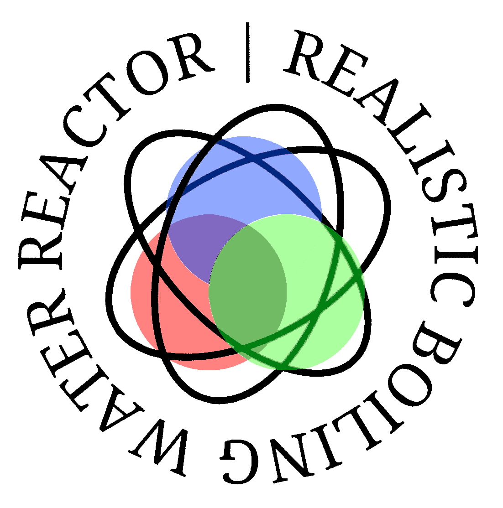

  

# Lua Nuclear Reactor

A Lua-based recreation of Unit 1 from 
[**Realistic Boiling Water Reactor Simulator**](https://www.roblox.com/games/11765852158/Realistic-Boiling-Water-Reactor-Simulator).

The goal is to recreate the reactor's systems and their interactions, including reactor physics, emergency cooling, turbine operation, and electrical systems.

## Project Status

| System | Status |
|---|---|
| Reactor Physics | Planned |
| ECCS (Emergency Core Cooling System) | Planned |
| MCC (Main Cooling Circuit) | In Progress |
| Turbine | Pressure, RPM, synchronisation and flow logic implemented |
| Condenser | Planned |
| Deaerator | Planned |
| Electrical Panel | Planned |

  

